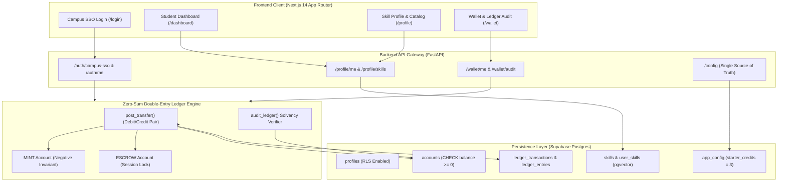
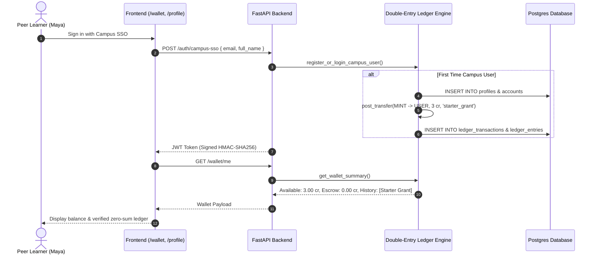

# SkillSwap: A Credit-Based Peer Skill Exchange Platform

[](https://github.com/sukhpree-t/ucs503p-202627-skillswap/actions/workflows/ci.yml)
[-black?logo=next.js)](https://nextjs.org/)
[](https://fastapi.tiangolo.com/)
[](https://supabase.com/)
[](LICENSE)
[](https://www.thapar.edu)

> **UCS503 — Software Engineering Lab Project (Academic Year 2026–27)**  
> **Department of Computer Science & Engineering, Thapar Institute of Engineering & Technology (TIET), Patiala**  
> **Group No:** 3C35  
> **Faculty Guide:** Dr. Tanya Garg  

---

## 👥 Project Team & Engineering Ownership

To ensure clear ownership and agile execution, the project responsibilities are divided into specialized frontend and backend domains:

| Team Member | Roll Number | GitHub Profile | Engineering Responsibilities |
| :--- | :--- | :--- | :--- |
| **Sukhpreet Singh** | `1024030541` | [@sukhpree-t](https://github.com/sukhpree-t) | **Backend & Systems Lead**<br>• Python FastAPI backend services<br>• Double-entry zero-sum credit ledger engine<br>• PostgreSQL database schema & transactional RPC functions<br>• Row Level Security (RLS) policies & database triggers<br>• CI/CD pipeline (`.github/workflows/ci.yml`) & automated tests |
| **Aditya Papneja** | `1024030066` | [@adityapapneja](https://github.com/adityapapneja) | **Frontend & UI/UX Lead**<br>• Next.js 14 App Router & TypeScript architecture<br>• Tailwind CSS responsive UI & design system<br>• Campus SSO authentication interface & error states<br>• Skill profile management (teaching/learning catalog)<br>• Time-credit wallet dashboard, ledger history & audit visualization |

---

## 📖 Executive Summary & Problem Statement

University campuses represent dense concentrations of diverse student talent—spanning programming, AI/ML, cloud infrastructure, design, mathematics, and spoken languages. However, existing peer-to-peer exchange is fragmented across informal group chats, leading to flaky scheduling, unmatched skill parity, and no accountability.

**SkillSwap** addresses this via a **decentralized, credit-based peer skill exchange economy**:
1. **Time-Banking Economy:** 1 hour taught = 1 time credit earned. Money is never exchanged.
2. **Double-Entry Zero-Sum Ledger:** Every transaction balances debits and credits (`SUM(accounts.balance) == 0`). System accounts (`MINT` and `ESCROW`) safeguard student balances.
3. **Campus SSO & Verified Identity:** Restricted to campus domain emails with role and reputation tracking.
4. **Guaranteed Escrow Protection:** Credits are escrow-locked at the moment of booking and settled upon mutual session completion, with auto-refund on mentor no-show.

---

## 🏗️ System Architecture & Request Flow



---

## 📐 UML Diagrams & Design Artifacts

SkillSwap adheres to strict Software Engineering design principles. Complete design artifacts are cataloged in [`docs/Diagrams/`](docs/Diagrams):



---

## 🏃 Agile Scrum Sprint Roadmap (7 Sprints)

| Sprint | Focus / Goal | Committed Stories | Story Points | Status |
| :---: | :--- | :--- | :---: | :---: |
| **Sprint 1** | **Foundation, Identity & Wallet**: Setup, Campus SSO, Profiles, Double-entry Wallet | US-01, US-02, US-04 | 9 | **DONE** |
| **Sprint 2** | **Availability & Discovery**: Mentor slots, Semantic Search with pgvector, Mentor Profiles | US-08, US-05, US-07 | 15 | Planned |
| **Sprint 3** | **Booking & Escrow Core**: Slot locking with Redis mutex, Escrow RPC, Low-balance alerts | US-10, US-11, US-13 | 12 | Planned |
| **Sprint 4** | **Live Session Collaboration**: Jitsi JWT integration, Session room, Code editor & Whiteboard | US-14, US-15 | 13 | Planned |
| **Sprint 5** | **Settlement, No-Show & Feedback**: Dual sign-off, No-show auto-refund, Mutual rating/review | US-16, US-17, US-18 | 13 | Planned |
| **Sprint 6** | **Disputes & Governance**: Dispute filing, Admin arbitration console, Zero-sum ledger audit | US-19, US-20, US-21 | 11 | Planned |
| **Sprint 7** | **Trust & Enhancements**: Skill quiz, Reciprocal matching filter, Calendar export/sync, Badges | US-03, US-06, US-09, US-12, US-22 | 17 | Planned |

*Detailed sprint progress and Given/When/Then acceptance criteria are tracked in [BACKLOG.md](BACKLOG.md) and [`docs/sprints/`](docs/sprints).*

---

## 🧪 Sprint 1 Verification & Demonstration Evidence

| User Story | Title | Points | Acceptance Criteria Result | Evidence Artifact |
| :--- | :--- | :---: | :---: | :---: |
| **US-01** | Sign in with Campus SSO | 3 | **PASS** | Auto-mints 3 starter credits via double-entry transaction; domain validation verified |
| **US-02** | Manage skill profile | 3 | **PASS** | Added teaching & learning skills; `embedding_stale = true` flag verified |
| **US-04** | View wallet and history | 3 | **PASS** | Available Balance = 3.00 cr, Escrow = 0.00 cr, zero-sum solvency audit verified ($\Delta = 0$) |

### Test & Code Quality Invariants:
- **Pytest Suite:** 17 tests passing (`tests/test_api.py`, `tests/test_ledger.py`, `tests/test_embedding_stale.py`)
- **Ledger Code Coverage:** **92% statement coverage** (exceeds the $\ge 70\%$ DoD threshold)
- **TypeScript:** Strict type checking with 0 compiler errors (`npx tsc --noEmit`)
- **ESLint:** 0 warnings, 0 errors (`npm run lint`)
- **Continuous Integration:** Fully automated multi-stage GitHub Actions CI pipeline ([`.github/workflows/ci.yml`](.github/workflows/ci.yml))

---

## 🚀 Getting Started Locally

### Prerequisites
- Python 3.11+
- Node.js 20+ and npm 10+
- Git

### 1. Clone & Setup Repository
```bash
git clone https://github.com/sukhpree-t/ucs503p-202627-skillswap.git
cd ucs503p-202627-skillswap
```

### 2. Backend Setup (FastAPI)
```bash
python3 -m venv .venv
source .venv/bin/activate
pip install -r <(echo "fastapi uvicorn pyjwt pytest pytest-cov httpx redis")
# Launch backend server on port 8001
uvicorn skillswap_backend:app --port 8001 --host 0.0.0.0
```

### 3. Frontend Setup (Next.js 14)
```bash
cd frontend
npm install
npm run dev
# The frontend will be available at http://localhost:3000
```

### 4. Running Verification Test Suite
```bash
# Run backend pytest with coverage enforcement
PYTHONPATH=. .venv/bin/pytest tests/ --cov=skillswap_ledger --cov-report=term-missing

# Run frontend type check and linter
cd frontend && npx tsc --noEmit && npm run lint
```

---

## 📄 License
This project is licensed under the MIT License — see the [LICENSE](LICENSE) file for details.
