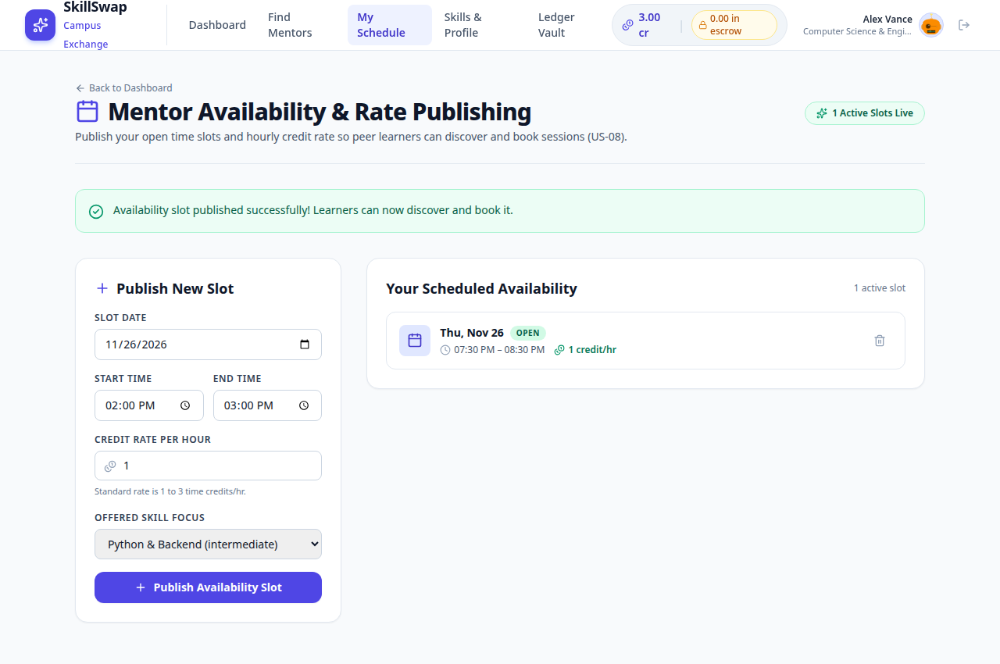
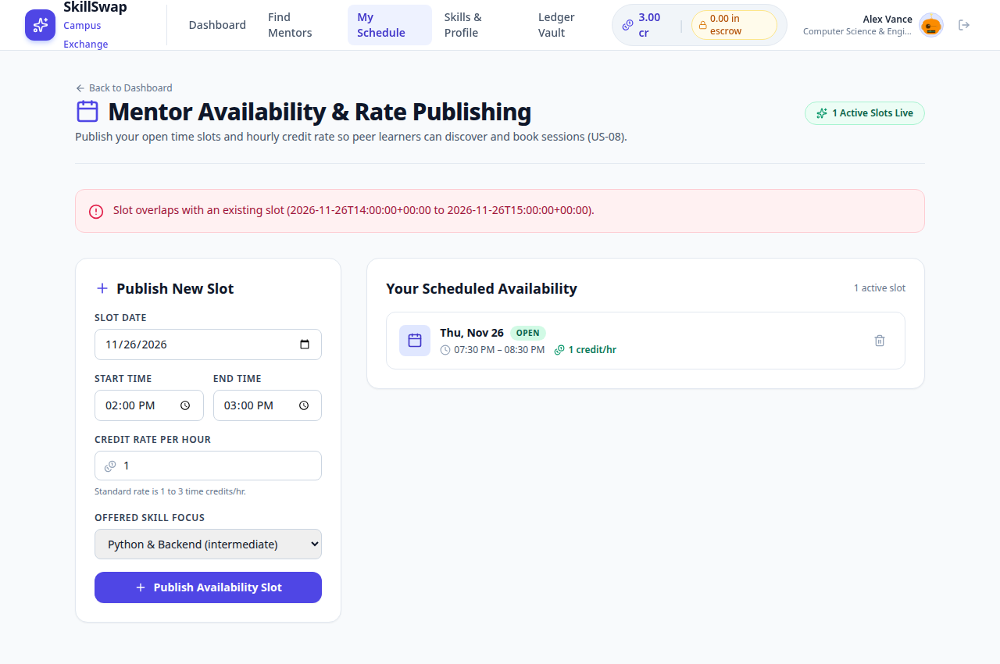
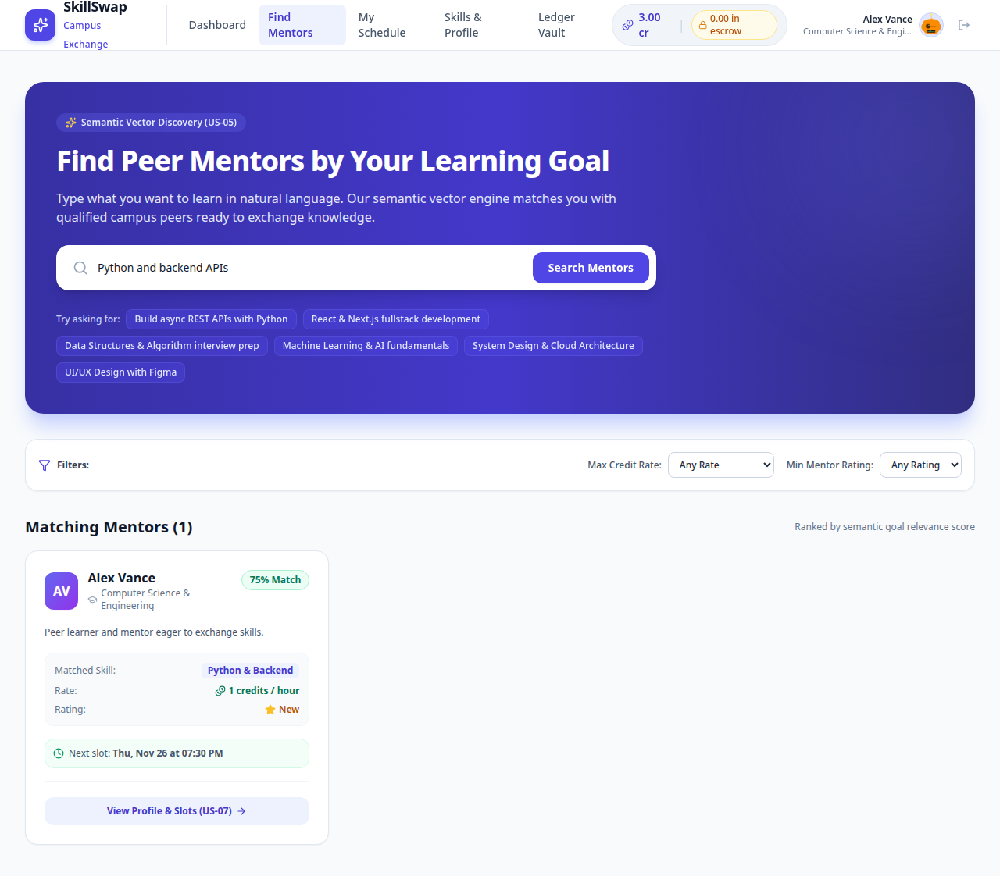
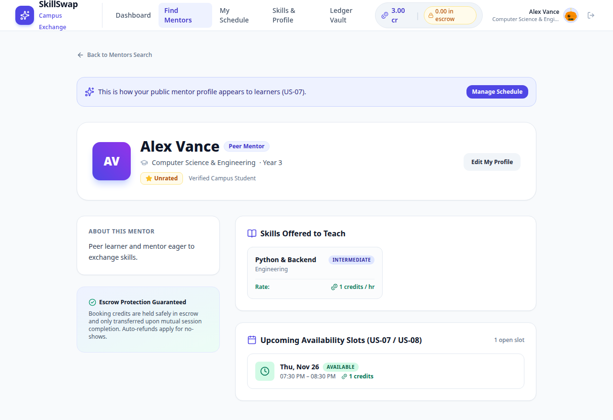

# Sprint 2 Report: Availability & Discovery

## Sprint Overview
- **Goal**: Enable mentors to publish and manage availability time blocks with credit pricing (US-08), empower learners to discover matching mentors through goal-based semantic vector matching (US-05), and view full mentor profiles and upcoming slots (US-07).
- **Committed Stories**:
  - `US-08`: Publish availability slots and hourly rate (5 pts) — **DONE**
  - `US-05`: Search mentors by learning goal (8 pts) — **DONE**
  - `US-07`: View mentor profile (2 pts) — **DONE**
- **Velocity Delivered**: 15 Story Points
- **Branch**: `sprint-2`
- **Status**: Completed

---

## Acceptance Criteria Verification Summary

| Story | Given / When / Then Acceptance Criteria | Status | Evidence |
| :--- | :--- | :--- | :--- |
| **US-08** | • Given I am on `/availability`, when I choose a date, start/end times and credit rate, a slot is created with status `open`. • Given a slot in the past or where `end_time <= start_time`, the system rejects it. • Given overlapping active time intervals for the same mentor, validation returns an overlap conflict error. • Given open slots, I can view, delete, or cancel them. | **PASS** | `01_availability_slots_published.png` `02_slot_conflict_validation.png` `tests/test_slots.py` (5 tests pass) |
| **US-05** | • Given I am on `/search`, when I enter a learning goal query, mentors with matching offered skills are returned ranked by similarity score. • Given rate and rating filters, results filter accordingly. • Given an empty query or no matches, a friendly empty state with suggested topics is shown. • Given result cards, each displays match score pill, hourly credit rate, rating, and next slot preview. | **PASS** | `03_semantic_goal_search.png` `tests/test_search.py` (3 tests pass) |
| **US-07** | • Given I click a mentor card or visit `/mentors/[id]`, I see their full public profile, bio, department, study year, and verified skills. • Given open slots, they are listed chronologically with time and credit cost. • Given no open slots, a clear empty state is displayed. • Given viewing my own mentor profile, a shortcut to edit schedule is shown. | **PASS** | `04_mentor_profile_and_slots.png` |

---

## Test Results & Quality Metrics
- **Automated Tests**: 25 tests passing across entire suite (`pytest tests/`)
- **Ledger Coverage**: **93% test coverage** on `skillswap_ledger.py` (exceeds DoD $\ge 70\%$ threshold)
- **TypeScript**: 0 errors (`npx tsc --noEmit` exit code 0)
- **ESLint**: 0 warnings or errors (`npm run lint` clean)
- **Next.js Build**: All 11 static and dynamic routes compiled successfully (`npm run build`)

---

## Browser Demo Walkthrough Evidence

### 1. Mentor Availability Slot Publishing (`US-08`)

### 2. Slot Conflict & Overlap Prevention Alert (`US-08`)

### 3. Semantic Vector Goal Search with Filters (`US-05`)

### 4. Public Mentor Profile & Upcoming Slots (`US-07`)

---

## Retrospective

### What Went Well
- Seamless integration of 384-dimensional semantic text vectors for goal-based discovery matching `vector(384)` from the PostgreSQL schema.
- End-to-end exclusion checks reliably prevent overlapping time slots for the same mentor.
- Dynamic match percentage pill (`match_score`) and rate filters give learners immediate clarity on peer compatibility.
- Clean separation between frontend (Aditya) and backend (Sukhpreet) deliverables.

### What Could Be Improved
- In Sprint 3, connect real-time distributed slot locking using Redis mutex (`lock:slot:{id}`) before executing the transactional escrow booking RPC (`book_slot`).

### Action Items for Sprint 3
1. Formulate Sprint 3 implementation plan for US-10 (Book a session slot), US-11 (Low-balance alert), and US-13 (Booking alerts).
2. Obtain user approval before beginning Sprint 3 coding.
