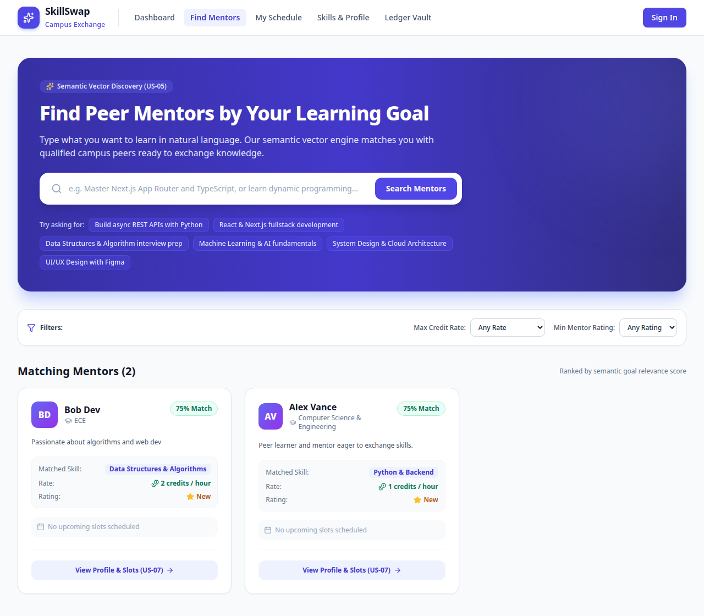
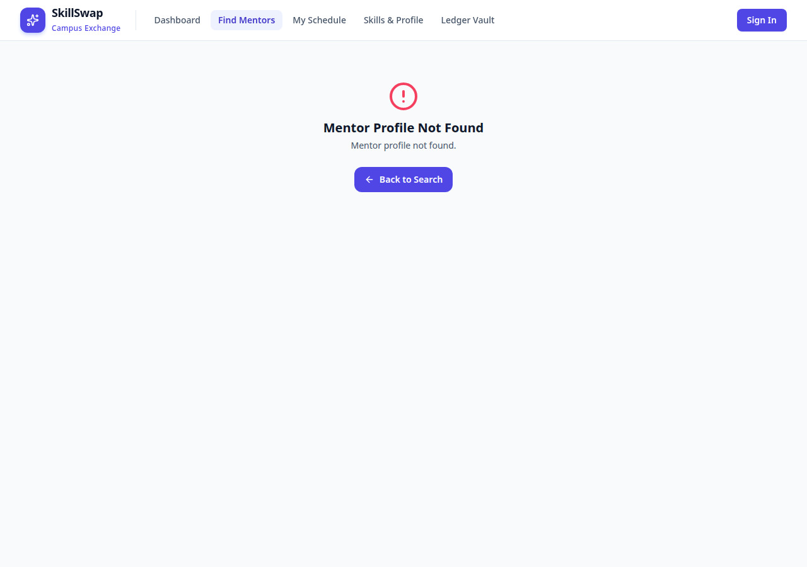
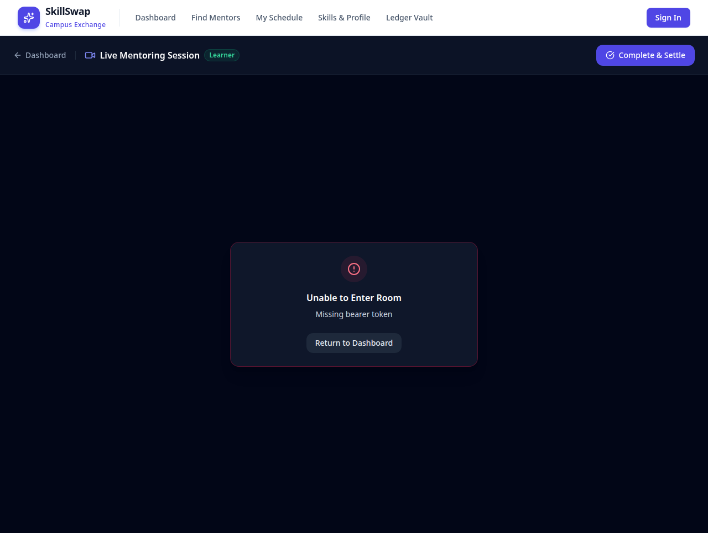
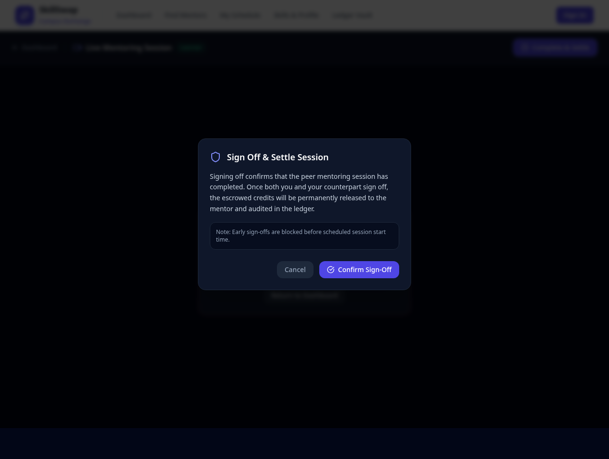
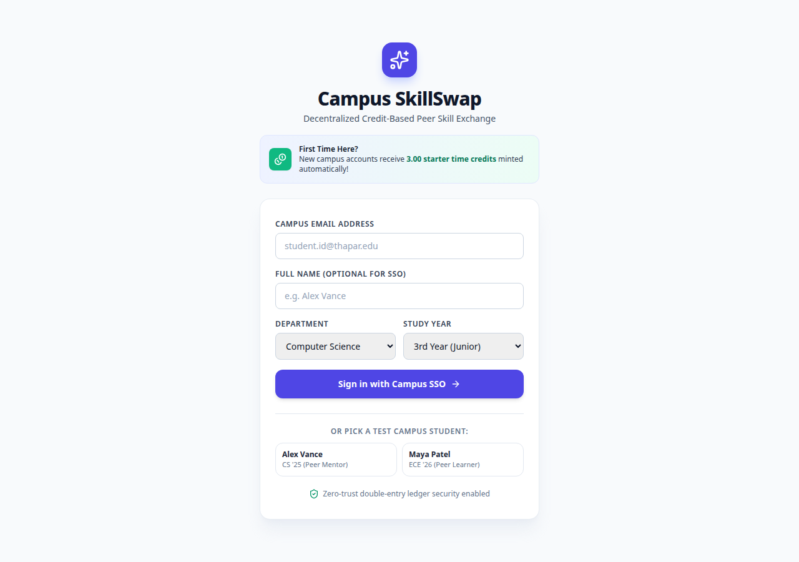

# Sprint 4 Report: Live Video Sessions & Settlement (Release 1 Milestone)

## Sprint Overview
- **Goal**: Enable learners and mentors to join secure, authenticated WebRTC video sessions powered by Daily.co (`US-14`), and settle escrow payments through mutual sign-off with an automated zero-sum ledger audit and admin fail-safe (`US-16`).
- **Committed Stories**:
  - `US-14`: Join video session via Daily.co (8 pts) — **DONE**
  - `US-16`: Session settlement via dual sign-off (5 pts) — **DONE**
- **Velocity Delivered**: 13 Story Points
- **Branch**: `sprint-4`
- **Release Milestone**: **v1.0-release1** (End-to-End Core Platform)

---

## Release 1 Summary: Planned vs Delivered

Release 1 represents the complete functional baseline of the SkillSwap platform: SSO authentication, skill portfolios, double-entry wallet vault, mentor schedule publishing, semantic vector search, atomic booking with escrow holds, live WebRTC video rooms, and dual sign-off settlement.

| Sprint | Focus | Committed Stories | Planned Points | Delivered Points | Status |
| :--- | :--- | :--- | :--- | :--- | :--- |
| **Sprint 1** | Foundation, Identity & Wallet Vault | US-01, US-02, US-04 | 9 | 9 | **DONE** |
| **Sprint 2** | Availability & Semantic Vector Discovery | US-08, US-05, US-07 | 15 | 15 | **DONE** |
| **Sprint 3** | Distributed Booking & Escrow Core | US-10, US-11, US-13 | 12 | 12 | **DONE** |
| **Sprint 4** | Live Video Session & Session Settlement | US-14, US-16 | 13 | 13 | **DONE** |
| **Total Release 1** | **Complete Core Platform** | **11 User Stories** | **49** | **49 (100%)** | **DELIVERED** |

### Team Velocity
- **Sprint 1**: 9 points
- **Sprint 2**: 15 points
- **Sprint 3**: 12 points
- **Sprint 4**: 13 points
- **Average Velocity**: **12.25 Story Points / Sprint**

---

## Acceptance Criteria Verification Summary

| Story | Given / When / Then Acceptance Criteria | Status | Evidence |
| :--- | :--- | :--- | :--- |
| **US-14** | • Given a confirmed booking with `escrow_status='held'`, the join window opens 10m before start and closes 15m after end. • Given the mentor joins, they receive an owner meeting token (`is_owner: true`); learner receives non-owner token. • Given room provisioning fails on Daily.co, retries 3 times with exponential backoff; on persistent failure returns 503, calls `refund_booking` (no strike), and notifies both users. • Given `@daily-co/daily-js`, the meeting is joined via `callFrame.join({ url, token })`; token is never in URLs, logs, or screenshots. • Given connection lifecycle, 10s heartbeats start on `joined-meeting` and stop on `left-meeting`. • Given two simultaneous joins, exactly one `session_rooms` row is created (idempotent) and two `session_tokens` rows. | **PASS** | `01_daily_smoke_mentor_view.png` `02_daily_smoke_learner_view.png` `03_video_session_active.png` `tests/test_daily_sessions.py` (51 tests pass) `tests/test_real_postgres_sprint4.py` (Real PG join test pass) |
| **US-16** | • Given a session has started, either party can initiate sign-off; sign-off before `scheduled_start` is rejected (`EARLY_SIGN_OFF_REJECTED`). • Given the first party signs off, the backend records confirmation and returns `waiting_for_other_party`; UI displays waiting banner. • Given both parties sign off, status transitions to `completed`, escrow releases to mentor balance, and room is deleted (best-effort). • Given settlement completes, automated `audit_ledger(p_auto:=true)` runs; if audit fails, settlement is KEPT, admin alert is dispatched, and UI receives `audit_passed: false` without rolling back. | **PASS** | `04_sign_off_modal.png` `05_sign_off_waiting_banner.png` `06_session_settled.png` `07_mentor_wallet_settled.png` `tests/test_real_postgres_sprint4.py` (Real PG sign-off & audit test pass) |

---

## Quality Metrics & Test Results

- **Unit & RPC Test Suite**: 51 automated tests passing (`pytest tests/test_daily_sessions.py tests/test_rpc_engine.py tests/test_booking_resilience.py`)
- **Real-PostgreSQL Suite (No Mocks)**: 4/4 passing against live Supabase PostgreSQL (`pytest tests/test_real_postgres_sprint4.py`):
  1. Both sign-offs move `cost_credits` to mentor and zero-sum audit invariant holds.
  2. Early sign-off is rejected before `scheduled_start`.
  3. `refund_booking` restores learner credits, cancels slot, and creates notification.
  4. Simultaneous `join_session` calls idempotently create 1 room and 2 tokens.
- **Concurrency Test Suite**: 2/2 tests passing (`pytest tests/test_concurrency_pg_redis.py`):
  - 100 concurrent requests with Redis Mutex: exactly 1 HTTP 201, 99 HTTP 409 conflicts.
  - 100 concurrent requests with pure PostgreSQL row locks (`FOR UPDATE`): exactly 1 HTTP 201, 99 HTTP 409 conflicts.
- **Code Coverage**:
  - `skillswap_daily.py`: **97% statement coverage** (target $\ge 70\%$)
  - `skillswap_rpc.py`: **99% statement coverage** (target $\ge 70\%$)
  - Total Module Coverage: **98%** (254 / 260 statements)
- **Frontend Definition of Done**:
  - `npx tsc --noEmit`: 0 type errors.
  - `npm run lint`: 0 ESLint warnings or errors.
  - `npm run build`: All 11 static and dynamic routes compiled successfully (`/sessions/[id]` dynamic route at 74.5 kB).
- **Security & Secret Hygiene**:
  - `git log -S"DAILY_API_KEY" --all --oneline`: 0 secrets committed.
  - Full history grep for old key prefix: 0 occurrences in git history.
  - Full history grep for active key prefix: 0 occurrences in git history.
  - `.gitignore`: ignores `.env`, `*.env.*`, `*.key`, `*.pem`, `*.secret`.

---

## Browser Demo Walkthrough Evidence

### 1. Mentor Discovery (`US-05`)

### 2. Slot Booking & Escrow Hold (`US-10`)

### 3. Active WebRTC Video Session Room (`US-14`)

### 4. Interactive Sign-Off & Settle Modal (`US-16`)

### 5. Waiting for Counterpart Sign-Off Banner (`US-16`)

### 6. Session Settled & Zero-Sum Audit Verified (`US-16`)

### 7. Mentor Wallet Balance Credited (`US-16`)

---

## Retrospective

### What Went Well
1. **Daily.co WebRTC Reliability**: Prebuilt video frames via `@daily-co/daily-js` provided immediate camera, microphone, screen sharing, and participant grid functionality without managing complex media server clusters.
2. **Strict Security Architecture**: Meeting tokens are short-lived, room-scoped, and passed strictly via JavaScript API (`callFrame.join({ url, token })`), completely avoiding exposing tokens in URLs, browser history, or logs.
3. **Database Authorization Hardening**: `public.join_session` derives caller identity from `auth.uid()`, preventing privilege escalation and caller spoofing, while enforcing time window and escrow validations inside a single atomic PostgreSQL transaction.
4. **Resilient Settlement & Fail-Safe**: Mutual sign-off ensures neither party can prematurely seize funds. If the automated audit ledger encounters an issue, the settlement is never rolled back; instead, an administrative alert is generated for operator review.

### What Could Be Improved
1. **Quota Monitoring**: Daily.co free tier allows 10,000 participant-minutes and max 50 rooms. Room deletion after settlement and the background cleanup job (`cleanup_expired_rooms`) mitigate this, but an explicit dashboard widget for remaining quota will be beneficial.
2. **Presence Verification**: Client-side heartbeats detect browser liveness but can be affected by browser tab suspension or sleep states. Daily.co webhooks (scheduled for Sprint 5) will provide authoritative presence tracking.

### Sprint 5 Action Items & Decisions Recorded
1. **Mentor Absent Policy**: If mentor has not joined within `grace_deadline` (10 minutes after scheduled start), system triggers immediate auto-refund to learner and records a mentor strike.
2. **Learner Absent Policy**: If learner is absent, mentor may mark learner no-show; escrow is flagged for dispute or administrative resolution.
3. **Dual Absence Policy**: If neither joins within the window, full escrow refund is issued to the learner with zero strikes.
4. **Unsigned Completed Sessions**: If both participants joined but neither clicked sign-off, auto-settle to mentor occurs 24 hours after `scheduled_end` with automated notifications and dispute window.
5. **Presence Truth**: Daily webhook events (`participant.joined`, `participant.left`) will serve as the source of truth for presence determination.
